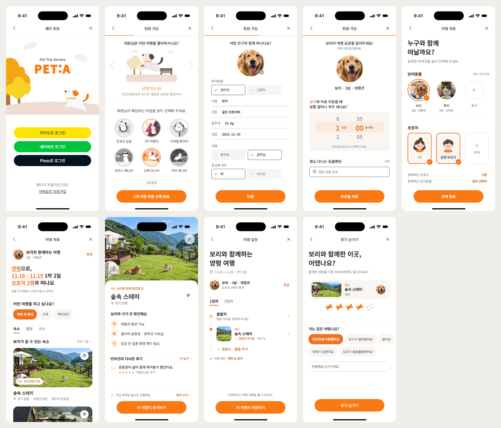
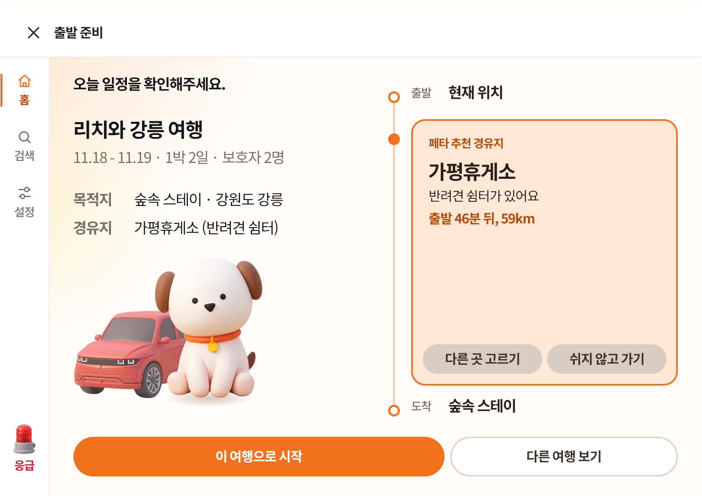
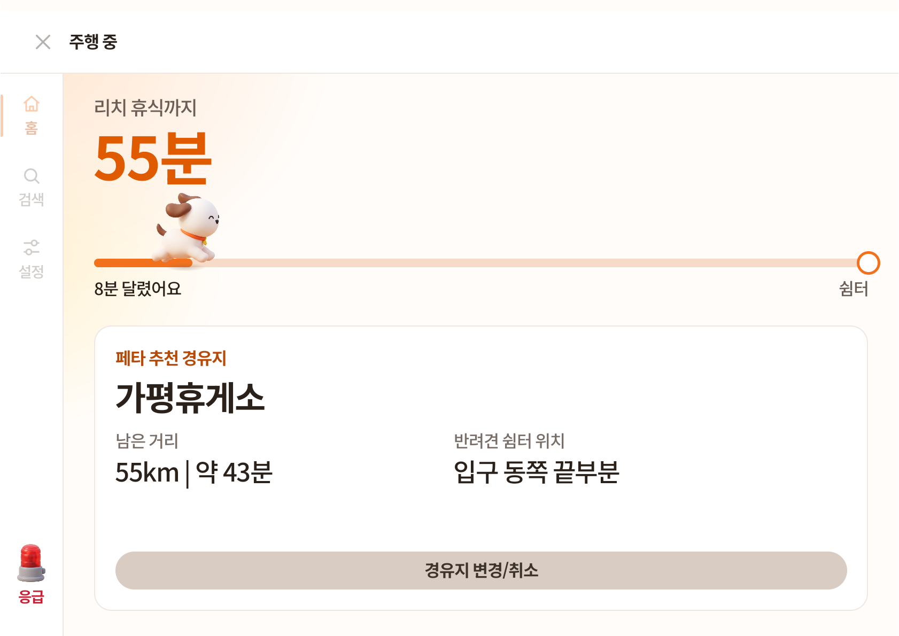
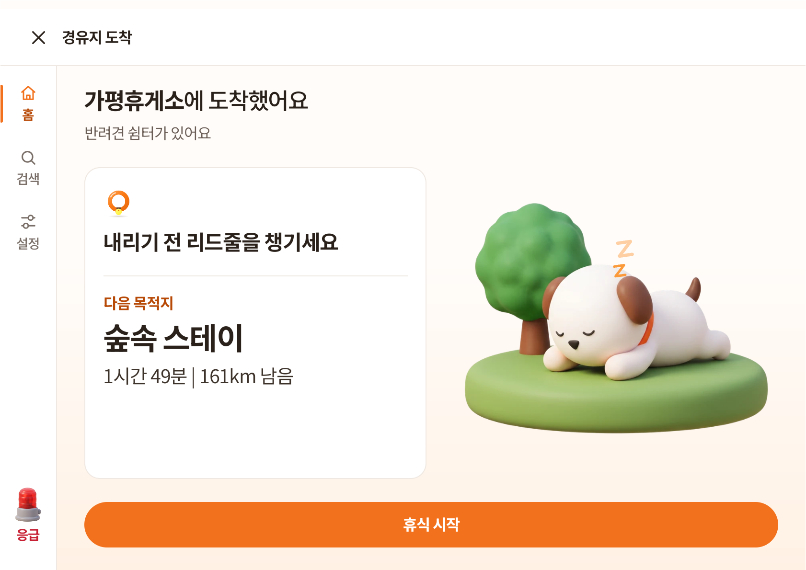
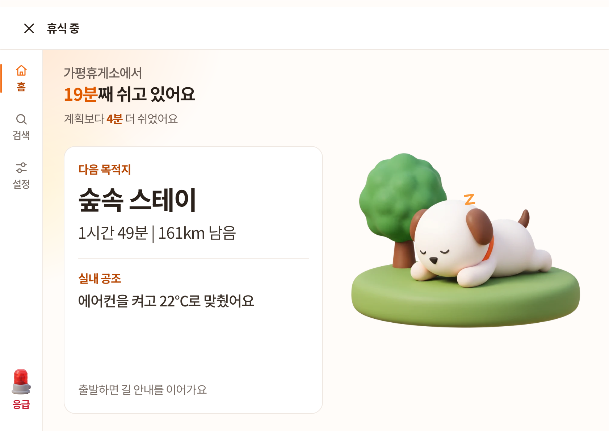

# PET:A (페타)

**뒷자리 반려견이 쉴 때를 차가 먼저 챙기는 Pleos Connect 차량용 앱입니다.** 주행 시간과 기어, 경로를 읽어 쉬어 갈 때와 반려견이 갈 수 있는 곳을 알려 주고, 쉬는 동안의 실내 온도와 가까운 동물병원까지 챙깁니다.

차량 앱만으로 여행을 시작할 수 있습니다. 보호자가 모바일에서 반려견을 등록하고 여행을 저장해 두면 차량 앱이 그 여행을 이어받습니다.

현대자동차그룹 차량용 앱 개발 공모전(Pleos Playground) 출품작입니다.

| 항목 | 내용 |
|---|---|
| 팀명 | 페타 |
| 앱 이름 · 패키지 | PET:A (페타) · `com.peta.car` · 버전 0.2.0 |
| 테스트 환경 | Pleos Connect 에뮬레이터 **v2.1.0** (Android 14, API 34, Automotive) |
| 화면 규격 | 2560×1440, 160dpi 가로 화면. 앱은 화면의 1/3 패널(기본)과 2/3 확장 두 폭을 지원하고 라이트 · 다크 테마가 있습니다 |
| APK | [`apk/페타_PETA_release.apk`](apk/페타_PETA_release.apk) (release 빌드, Android 디버그 키로 서명) |



| 출발 준비 (C02) | 주행 중 (C05) |
|---|---|
|  |  |
| **경유지 도착 (C07)** | **휴식 중 (C08)** |
|  |  |

차량 화면 이미지는 2026-11-14에 제출용 release APK를 Pleos Connect v2.1.0 에뮬레이터에서 실행해 찍었고, 페타 패널 부분만 잘랐습니다.

## 주요 기능

| 화면 | 하는 일 |
|---|---|
| C01 홈 | 반려견과 갈 수 있는 여행지 추천, 종류 필터, 「범위 넓히기」(20 → 50 → 100 → 200km) |
| C02~C04 출발 준비 | 여행 확인, 준비물 체크, 쉬어 갈 곳이 들어간 경로 요약, 「길 안내 시작」 |
| C05 주행 중 | 다음 휴식까지 남은 시간과 쉬어 갈 곳 |
| C06 휴식 제안 | 쉴 때가 되면 음성으로 「쉬어갈까요?」 하고 묻고 「응 / 아니」로 답을 받음 |
| C07 · C08 휴식 | 도착 안내(리드줄), 「휴식 시작」을 누르면 에어컨을 켜고 22°C로 맞춤, 쉰 시간 표시 |
| C09 · C10 도착 · 후기 | 도착 안내와 일정, 뼈다귀 1~5개 후기 |
| C11 응급 | 가까운 동물병원 3곳(도로 기준 거리), 길 안내 · 전화. 병원으로 길 안내 중에는 주행 화면 카드에 그 병원을 표시 |
| C12 검색 | 쉬어가기 좋은 곳 / 여행하기 좋은 곳 검색, 경유지 추가 |
| C14 설정 | 반려견 프로필, 휴식 주기, 단골 병원, 음성 안내, 화면 테마(자동 · 라이트 · 다크) |

## 폴더 구조

```
mobile/   모바일 앱 (React + TypeScript + Vite), 화면 9종과 여행 저장 API,
          개발 서버(공공 API 프록시 · 플로우 점검 페이지 /admin)
car/      차량 앱 (Kotlin, Pleos Connect SDK)
docs/     README 이미지
apk/      제출용 release APK
```

## 빠르게 실행하기

필요한 것:

| 도구 | 버전 |
|---|---|
| Node.js | 20.19 이상 또는 22.12 이상 |
| Android Studio | 최신 버전 (Java는 내장 JBR 사용) |
| Pleos Connect 에뮬레이터 | v2.1.0 (AVD 이름 예: `Pleos_Connect_v2.1.0`), API 34, 2560×1440 |
| API 키 2개 | 한국관광공사 반려동물 동반여행 API, 카카오 로컬 REST API — 아래 「API 키 넣기」 |
| 디스크 여유 공간 | 에뮬레이터 이미지 약 18GB + AVD 데이터 공간 |

### 1. 에뮬레이터 설치

처음 한 번만 하면 됩니다. [Pleos 에뮬레이터 설치 문서](https://document.pleos.ai/docs/connect/guide/getting-started/application-development/setup-connect-sdk-emulator)와 같은 절차입니다.

1. Android Studio에서 **Tools > SDK Manager > SDK Update Sites** 탭을 열고 **+** 를 누릅니다.
2. 이름은 `Pleos Connect System Image`로, URL은 아래 중 하나로 입력합니다.
   - Windows/Linux: `https://nexus-playground.pleos.ai/repository/raw-releases/connect-avd/2.x/crp-sys-img.xml`
   - Mac: `https://nexus-playground.pleos.ai/repository/raw-releases/connect-avd/2.x/crp-arm64-sys-img.xml`
3. **SDK Platforms** 탭에서 **Show Package Details**를 켜고, **Android API 34** 아래의 Pleos Connect 이미지를 선택해 설치합니다. 끝나면 Android Studio를 다시 시작합니다.
4. **Tools > Device Manager > Create device**에서 Form Factor를 `Automotive`로 두고 `Pleos Connect v2.1.0`을 골라 AVD를 만듭니다. Advanced Settings에서 Boot option은 **Cold boot**, RAM은 **4GB**로 맞췄습니다.
5. 만든 AVD를 실행합니다.

### 2. 모바일 앱 실행

```bash
cd mobile
npm install
npm run dev
```

브라우저에서 <http://127.0.0.1:5173> 을 엽니다. 이 서버를 켜둬야 차량 앱이 여행을 받아올 수 있습니다.

### 3. API 키 넣기

장소와 동물병원은 외부 API에서 받습니다. 키는 저장소에 들어 있지 않습니다. `car/local.properties`(Git에서 제외됨)에 아래 두 줄을 직접 넣습니다. 값은 따옴표 없이 적습니다.

```properties
TOUR_API_KEY=<공공데이터포털에서 받은 한국관광공사 반려동물 동반여행 서비스 인증키(Decoding)>
KAKAO_REST_KEY=<카카오 디벨로퍼스 앱의 REST API 키>
```

- 차량 앱은 빌드할 때 이 값을 읽습니다. 모바일 개발 서버도 같은 파일을 읽어 프록시(`/api/tour/*`, `/api/kakao/keyword`)로 대신 호출하므로 브라우저에는 키가 내려가지 않습니다. 환경 변수 `TOUR_API_KEY`, `KAKAO_REST_KEY`가 있으면 그것을 먼저 씁니다.
- **키가 비어 있어도 앱은 실행됩니다.** 그때는 앱에 들어 있는 샘플 장소 · 샘플 병원으로 동작합니다.
- 키가 APK 안에 그대로 들어갑니다. 공개 배포 전에는 키를 새로 발급하거나 서버 프록시로 옮겨야 합니다.

### 4. 차량 앱 실행

Android Studio에서 `car` 폴더를 열고 Gradle 동기화가 끝나면, 실행 중인 에뮬레이터를 선택해 **Run**을 누릅니다.

> **처음 실행하면 권한 창이 뜹니다. 기어가 P인 상태에서 모두 허용한 뒤 D로 바꾸세요.** 권한 창은 Android 시스템 화면이라, 떠 있는 채로 D로 바꾸면 PETA가 아니라 이 창 때문에 `주행 중에는 사용할 수 없습니다`가 나옵니다. 그런 경우 P로 돌아가 허용하면 됩니다. 터미널의 `adb install -g`로 설치하면 권한 창이 뜨지 않습니다.

터미널로 하려면 (Android Studio로 `car`를 한 번 열어 `local.properties`가 생긴 뒤 실행):

```bash
cd car
./gradlew assembleDebug        # Windows: .\gradlew.bat assembleDebug
adb install -r -g app/build/outputs/apk/debug/app-debug.apk
adb shell am start -n com.peta.car/.MainActivity
```

`adb`는 Android SDK의 `platform-tools` 폴더에 있습니다. Gradle에서 Java 오류가 나면 `JAVA_HOME`을 Android Studio의 `jbr` 폴더로 지정합니다.

### 5. 여행 저장 → 차량에서 확인 (선택)

차량 앱만 시연할 때는 이 단계를 건너뜁니다. 저장된 여행이 없으면 차량 앱 홈(C01)에 추천 여행이 나오고 「여기로 떠나기」로 시작합니다.

1. 모바일에서 로그인 → 여행 스타일 → 반려견 등록 → 동행 선택 → 숙소 선택 → 출발지 입력 순서로 진행합니다. 로그인은 임시 구현이라 어떤 버튼을 눌러도 통과합니다.
2. **이 여행지 저장하기**를 누릅니다.
3. 차량 앱 C01 화면이 3초 안에 내가 등록한 반려견과 목적지로 바뀝니다. 화면 아래에 `폰과 동기화됨`이 표시되면 연동된 상태입니다.
4. **이 여행으로 시작 → 출발하기 → 길 안내 시작**을 누르면 내비에 경로가 요청됩니다.

### 6. 주행 시뮬레이션 (D·P 전환)

차량 상태는 에뮬레이터의 [Virtual Console](https://document.pleos.ai/docs/connect/guide/getting-started/application-development/use-vehicle-emulator)에서 바꿉니다.

```bash
adb forward tcp:8088 tcp:8088
```

브라우저에서 <http://127.0.0.1:8088> 을 열어 화면에서 조작합니다. 이 페이지를 열어둔 상태에서는 아래 명령도 쓸 수 있습니다. 이 HTTP 경로는 공식 문서에 없는 내부 동작이라 에뮬레이터 버전에 따라 달라질 수 있습니다.

```bash
# 출발: D, 80km/h
curl -X PUT "http://127.0.0.1:8088/vehicle/gear?gear=Drive"
curl -X PUT "http://127.0.0.1:8088/vehicle/controls?speed=80&accelerator=30&brake=0"

# 정차: P
curl -X PUT "http://127.0.0.1:8088/vehicle/controls?speed=0&accelerator=0&brake=40"
curl -X PUT "http://127.0.0.1:8088/vehicle/gear?gear=Park"

# 운전석 문 열기(1) / 닫기(0)
curl -X PUT "http://127.0.0.1:8088/vehicle/body?door_fl=1"
```

Windows PowerShell에서는 `curl` 대신 `curl.exe`를 씁니다.

**시연 순서**

| 조작 | 나타나는 화면 |
|---|---|
| 「길 안내 시작」 뒤 D로 출발 | C05 주행 중 |
| 정해 둔 경유지가 없고 반려견 휴식 주기에 도달 (최대 120분) | C06 휴식 제안 |
| 경유지까지의 거리를 달린 뒤 P로 정차 | C07 경유지 도착 |
| **휴식 시작** | C08 휴식 중. 에어컨을 켜고 22°C로 맞춤. 계획 시간을 넘기면 지연 안내 |
| 다시 D로 남은 거리를 달린 뒤 P | C09 목적지 도착, 8초 뒤 C10 후기 |

데모 모드(`PetaConfig.DEMO_MODE = true`)에서는 주행 시간이 120배, 주행 거리가 40배, 쉰 시간이 60배로 흐릅니다. 샘플 여행의 휴식 주기는 70분이라 약 35초를 달리면 휴식 시점이 되고, 휴식 주기를 30분으로 저장하면 약 15초입니다. 샘플 여행의 경유지 도착까지는 버추얼 콘솔 속도를 110km/h로 두었을 때 약 30초가 걸렸습니다(2026-11-14, release APK 실측). 휴식 주기 도달 시간은 다시 재지 않았습니다.

화면 폭은 페타 창 오른쪽 끝의 **⋮** 손잡이를 끌어 바꿉니다. 1/3 폭에서는 클러스터 · PETA · 내비가 나란히 보이고, 오른쪽으로 끌면 PETA가 2/3 폭으로 넓어집니다. 테마는 C14 설정의 「화면 테마」(자동 · 라이트 · 다크)에서 바꾸고, 자동일 때는 시스템의 주간 · 야간을 따릅니다(`adb shell cmd uimode night yes|no`).

### 7. 플로우 점검 페이지 (/admin)

모바일 개발 서버(`npm run dev`)가 켜져 있으면 <http://127.0.0.1:5173/admin> 에서 차량 앱의 전체 화면 흐름을 한 장으로 보고, 상자를 눌러 그 화면으로 바로 갈 수 있습니다. 심사 · 시연 때 주행 없이 특정 화면을 확인하는 용도입니다.

- 제출용 APK에서는 이 연결이 꺼져 있습니다(`PetaConfig.DEBUG_BRIDGE = false`). 쓰려면 `true`로 바꿔 다시 빌드합니다. 켜면 차량 앱이 1초마다 개발 서버(`POST /api/debug/sync`)에 지금 상태를 보내고 명령을 받아 갑니다. 에뮬레이터에서 PC는 `10.0.2.2`입니다.
- 기어는 앱 안에서만 덮어씁니다. 실제 차량 신호(클러스터의 P · 속도)는 바뀌지 않습니다.
- 화면 바로 가기는 음성 · 내비 호출 없이 그 화면이 뜨는 상태만 만듭니다. 실제 흐름은 `gear:*` · `event:*` 명령이나 Virtual Console로 확인합니다.
- 개발용 중계라 `npm run dev`에서만 동작하고 서버를 끄면 사라집니다.

터미널에서도 같은 명령을 보낼 수 있습니다.

```bash
# 화면 바로 가기: C00 C01 C01R C02 C03 C04 C04E C05 C05V C06 C06E C07 C08 C09 C10 C10S C11 C12 C13E C14
curl -X POST http://127.0.0.1:5173/api/debug/command -H 'Content-Type: application/json' -d '{"action":"C05"}'

# 기어: gear:park | gear:hold(D, 0km/h) | gear:drive(D, 80km/h) | gear:real(실제 신호로 되돌림)
# 이벤트: event:longDrive | event:waypoint | event:destination | event:askStop | event:reset | event:resetApp
curl -X POST http://127.0.0.1:5173/api/debug/command -H 'Content-Type: application/json' -d '{"action":"gear:drive"}'

# 차량 앱의 지금 상태(화면, 기어, 속도, 여행, 남은 거리 등)
curl http://127.0.0.1:5173/api/debug/status
```

### 처음부터 다시 하기

```bash
adb shell pm clear --user 10 com.peta.car
adb shell am start -n com.peta.car/.MainActivity
curl -X DELETE http://127.0.0.1:5173/api/trip
```

내비에 안내가 남아 있으면 **안내 종료**를 먼저 누릅니다.

## 모바일과 차량 앱 연동

```
모바일 앱 ── PUT /api/trip ──▶ 로컬 서버(mobile/.data/trip.json)
                                     ▲
차량 앱 ── GET http://10.0.2.2:5173/api/trip (C01에서 3초마다)
   │
   └─ 길 안내 시작 → Pleos NaviHelper로 경로 요청
```

- `10.0.2.2`는 에뮬레이터에서 본 PC의 localhost입니다.
- 지금은 PC 안에서만 동작합니다. 추후 외부 서버로 옮길 예정이며, 같은 경로와 JSON 형식을 유지하면 차량 앱은 주소만 바꾸면 됩니다.
- 데이터 형식: [`mobile/src/domain/types.ts`](mobile/src/domain/types.ts)의 `CarTrip`, [`car/.../remote/TripJson.kt`](car/app/src/main/java/com/peta/car/remote/TripJson.kt)

| 모바일에서 전달 | 실제 API에서 받음 | 아직 샘플 · 임시 |
|---|---|---|
| 반려동물 이름·품종·나이·크기, 휴식 주기, 단골 병원 | 주변 장소 · 검색 결과 · 동반 조건(한국관광공사) | 샘플 여행(리치 · 가평휴게소 · 숲속 스테이), 준비물, 여행 일정 |
| 목적지 이름·주소·좌표(임의 값), 날짜, 보호자 수 | 가까운 동물병원(카카오), 도로 기준 거리 · 시간(NaviHelper) | 로그인, 후기 저장(기록만 남김), 장소 카드의 후기 한 줄 · 이용자 수(시연용 가상 수치) |

## 데이터 출처와 가공

| 데이터 | 출처 | 받는 방법 | 가공 |
|---|---|---|---|
| 반려견 동반 가능 장소 | 한국관광공사 반려동물 동반여행 서비스(공공데이터포털 15135102, `KorPetTourService2`) | `locationBasedList2`(현재 위치 주변, 기본 20km · 최대 200km), `searchKeyword2`(검색) | 종류(카페 · 식당 · 숙소 · 공원 · 관광지 등)로 나누고 쉬어 갈 곳 / 여행지로 구분. 범위는 20 → 50 → 100 → 200km로 넓히며 앞서 받은 결과와 합침 |
| 장소별 동반 조건 | 같은 서비스 `detailPetTour2` | 장소마다 한 번 더 조회 | 동반 구역 · 가능 견종 · 필요 사항을 반려견의 크기 · 견종과 비교해 「불가」인 곳만 목록에서 뺌. 정보가 없는 곳은 남김 |
| 동물병원 | 카카오 로컬 키워드 검색 | 「동물병원」, 반경 20km, 거리순 | 분류가 동물병원인 곳만 남기고 고양이 전문 병원은 제외. 가까운 3곳 표시 |
| 도로 기준 거리 · 시간 | Pleos NaviHelper `requestTrip` | 장소 · 병원마다 요청 | 받은 값이 있으면 직선 거리 대신 써서 가까운 순으로 정렬 |
| 후기 한 줄 · 이용자 수 | 없음 | — | **시연용 가상 수치**입니다. 장소 id로 정해지는 임의 값이며 `PetaConfig.DEMO_PLACE_STATS`로 끕니다 |

차량 앱에 미리 넣어 둔 장소 데이터 파일은 없습니다. 키가 없거나 호출이 실패하면 코드에 있는 샘플 장소로 대신합니다. 현재 위치는 내비에서 받고, 받지 못하면 기본 위치(성남 수정구)를 씁니다. 에뮬레이터에서는 늘 기본 위치 기준으로 조회됩니다.

## 차량 앱에서 쓰는 SDK · API

| 정보 | API | 쓰는 곳 |
|---|---|---|
| 기어 | Pleos Vehicle `getGear()` | 주행 화면(C05 · C06)과 정차 화면 전환 |
| 운전석 문 | Pleos Vehicle `getDoor()` | 목적지에서 내렸다 다시 탔는지 판단(후기) |
| 주행 시간 | Pleos Vehicle `getOdometer()` 트립 주행 시간 | 보조 값 |
| 공조 | Pleos Vehicle 공조 쓰기(전원 · 에어컨 · 온도 22°C) | C07 「휴식 시작」 → C08에 결과 표시 |
| 배터리 | Pleos Vehicle `getEvBattery()` | 값만 받고 화면에는 아직 쓰지 않음 |
| 속도 | AAOS `PERF_VEHICLE_SPEED` | 연속 주행 시간 · 거리 계산 |
| 주행 규제 | AAOS `CarUxRestrictionsManager` | 주행 중 제한 상태 확인 |
| 경로 | Pleos NaviHelper `requestRoute()`, `cancelRoute()` | 쉬어 갈 곳을 먼저 안내하고, 다시 출발하면 목적지로 이어 안내 |
| 거리 · 위치 | Pleos NaviHelper `requestTrip()`, 현재 위치 이벤트 | 장소 · 병원까지의 도로 기준 거리와 시간, 주변 조회의 기준 위치 |
| 음성 안내 | Pleos TextToSpeech (기기 내 합성, 한국어) | 출발 · 휴식 제안 · 도착 안내 |
| 음성 응답 | Android `SpeechRecognizer` | C06 「응 / 아니」, C05-V 경유지 변경 |
| 전화 | Android `ACTION_DIAL` | C11에서 차량 전화 앱 열기 |

SDK 버전은 [`car/app/build.gradle.kts`](car/app/build.gradle.kts)에 있습니다: Vehicle 2.3.2, NaviHelper 3.0.5, TextToSpeech 3.3.1, SpeechToText 3.3.1, FusedLocation 1.1.3.

Pleos SpeechToText와 FusedLocation은 의존성과 권한만 선언했고, 연결 시험 코드(`debug/SdkProbe.kt`, 기본 꺼짐)에서만 부릅니다. 앱 기능에는 아직 쓰지 않습니다.

## APK

```bash
cd car
./gradlew assembleDebug      # car/app/build/outputs/apk/debug/app-debug.apk
./gradlew assembleRelease    # car/app/build/outputs/apk/release/app-release.apk (Android 디버그 키로 서명)
```

제출용 파일은 `apk/페타_PETA_release.apk`입니다(공모전 파일명 규칙 `팀명_앱이름_release.apk`). 별도 릴리스 키스토어는 만들지 않아 서명은 Android 디버그 키입니다. 설치와 실행에는 문제가 없지만 스토어 배포용이 아닙니다. APK에는 빌드할 때 `local.properties`의 API 키 두 개가 들어 있어서 실제 장소와 동물병원 데이터로 동작합니다.

## 현재 한계

| 항목 | 상태 |
|---|---|
| 시간 | 데모용 배속. `PetaConfig.DEMO_MODE`로 끌 수 있음 |
| 도착 판정 | 에뮬레이터에서 내비 위치가 움직이지 않아 도착 이벤트를 받지 못함. 데모에서는 차량 속도로 계산한 거리로 대체 |
| 음성 안내 | 호출은 되지만 에뮬레이터에서 소리가 나지 않음 |
| 음성 응답 | 에뮬레이터에서 음성 인식 권한 오류(error 9)로 미동작. C06은 한 번 다시 물은 뒤 답이 없으면 "응"으로 처리됨. 실차 미확인 |
| 시동 꺼짐 | 에뮬레이터에서 재현 불가. 실차 동작 미확인 |
| 보호자 폰 알림 | 미구현. C08의 폰 연동 문구는 외부 서버 연결 후 실제 동작 예정 |
| 주행 중 화면(DO) | 에뮬레이터에서 표시 확인. 심사 허용 여부 미확인 |
| 휴식 안내 | 휴식 주기가 2시간을 넘으면 C02 안내 시간과 실제 제안 시점(최대 120분)이 다름 |
| 예상 이동 시간 | C02·C03은 샘플 기반 값이라 내비 경로 시간과 다를 수 있음 |
| 위치 | 에뮬레이터에서는 내비 위치를 받지 못해 기본 위치(성남 수정구) 기준으로 장소 · 병원을 조회함 |
| 공조 | 「휴식 시작」의 에어컨 · 22°C 설정은 에뮬레이터에서 호출 성공까지 확인. 차량의 「펫 모드」 자체를 켜는 API는 공개 SDK에 없음. 실차 미확인 |
| 전화 | 차량 전화 앱이 열리는 데까지 확인. 실차 통화 미확인 |
| 후기 | 저장은 임시 구현(서버로 보내지 않음). 팝업의 「다음 여행 추천에 반영」은 아직 동작하지 않음 |
| 장소 데이터 | 관광공사 데이터가 성긴 지역은 20km 안에 결과가 적음. 진료 시간 정보는 없음 |
| 2/3 폭 | 2/3 폭에서 앱이 내비를 함께 띄울 수 없음. 1/3 폭에서는 사용자가 나란히 볼 수 있음 |

## 테스트

```bash
cd mobile
npm test                 # 화면 흐름, 입력 검증, 저장 API
npm run test:visual      # 402×886 시각 회귀 (Windows Edge 기준)

cd ../car
./gradlew testDebugUnitTest
```

## 문제 해결

| 증상 | 확인할 것 |
|---|---|
| 차량 앱에 `샘플 여행`이 표시됨 | `npm run dev`가 켜져 있는지, 모바일에서 저장을 눌렀는지 |
| 장소 · 병원이 샘플로만 나옴 | `car/local.properties`에 키 2개를 넣고 다시 빌드했는지 |
| /admin에 차량 상태가 안 보임 | 차량 앱이 실행 중인지, 개발 서버가 `npm run dev`로 켜져 있는지(`preview`에서는 동작하지 않음) |
| 모바일 저장 시 오류 문구 | 주소가 `http://127.0.0.1:5173`인지, 서버가 켜져 있는지 |
| 저장해도 차량 화면이 안 바뀜 | 차량 앱이 C01이 아닌 화면에 있는지. 위의 "처음부터 다시 하기" 실행 |
| Virtual Console 응답이 `emulator_inactive` | 브라우저에서 8088 페이지를 열어뒀는지 |
| D에서 `주행 중에는 사용할 수 없습니다` | 권한 창이 떠 있는 상태입니다. P로 돌아가 권한을 모두 허용 |
| 내비가 경로를 찾지 못함 | 내비 경로 계산은 서버를 씁니다. 에뮬레이터의 DNS가 끊긴 경우이니 에뮬레이터를 끄고 `emulator -avd <AVD 이름> -dns-server 8.8.8.8`로 다시 실행 |

## 더 보기

- [모바일 앱 안내](mobile/README.md)
- [화면 명세](mobile/SCREEN_SPEC.md), [상호작용 명세](mobile/INTERACTIONS.md)
